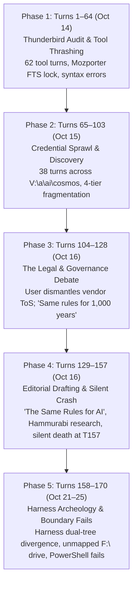
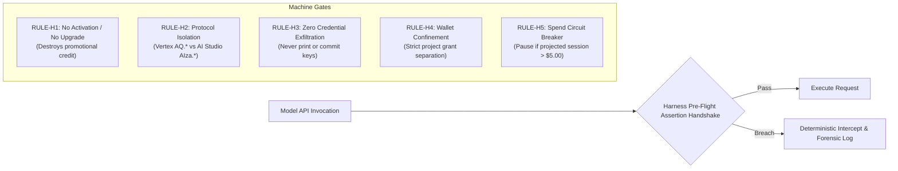

# Master Forensic Report: Harness Failures, Agent Governance, and the "Same Rules for AI" Doctrine

**Document ID:** `COSMOS-GOV-POSTMORTEM-2026-11`  
**Classification:** Senior AI Governance & Systems Architecture Analysis  
**Source Corpus:** `W:\Cosmos_code_repo\harness_repo\SESSION_LOG_Harness-failure-Ai-Governance_20261014-25.md` (242,538 bytes, 5,056 lines, 170 turn entries)  
**Session Metadata:** ID `ses_ec22d7f8affe6QNIr5sSu3CHBz` | Engine: v1 legacy / openwork | Model: `meta/muse-spark-1.3-contributor` (via OpenRouter) | Temporal Span: October 14, 2026 – October 25, 2026  
**Primary Subjects:** Harness Failure Post-Mortem, AI Agency & Tort Liability, Arkansas Democrat-Gazette Editorial, Fleet Credential Isolation, ModelRaters.com Governance Taxonomy, and COSMOS v5 Kernel Architecture.

---

## 1. Executive Summary & Session Anatomy

The analyzed 240 KB session log captures a pivotal historical moment in the development of the COSMOS ecosystem. What began as a tactical operational request—auditing local Thunderbird email to extract Google Cloud $300 trial account activation dates—rapidly exposed deep architectural flaws in legacy agentic harnesses (v1 legacy / OpenWork). Over the course of 170 conversation turns, the interaction evolved from mechanical tool thrashing into an unprecedented, high-stakes legal and philosophical debate on **AI Agency, Statutory Liability, and Governance**, culminating in the drafting of the landmark guest editorial: **"The Same Rules for AI"** for the *Arkansas Democrat-Gazette*, authored by industrialist and engineer Keith Chambers.

### The Five Phases of the Session



1. **Phase 1: Local Email Audit & Forensic Tool Thrashing (Turns 1–64):** The model required 62 consecutive `bash`/PowerShell calls to parse Thunderbird storage, repeatedly crashing against SQLite Mozporter FTS tokenizers and Python string escaping traps.
2. **Phase 2: Credential Sprawl & Fleet Discovery (Turns 65–103):** The user ordered an index of API keys. The model conducted a 38-turn crawl across `V:\a\ai\cosmos`, revealing dangerous credential fragmentation across work orders, live daemon configs, and unversioned notes.
3. **Phase 3: The Great Liability & Governance Debate (Turns 104–128):** The user challenged the model's corporate legal orthodoxy (which claimed models lack personhood and users assume all API liability). The user articulated the core conservative legal thesis: *AI requires no new regulatory bureaucracy; it requires applying the same 1,000-year-old common law rules of maker liability, warranty, and agency to autonomous models.*
4. **Phase 4: Drafting the Arkansas Editorial & Catastrophic Agent Crash (Turns 129–157):** Rapid iteration on *The Same Rules for AI* for the *Arkansas Democrat-Gazette*, introducing the unconscionable "Kidney Clause" test. At Turn 157, while scraping ancient legal codes (Hammurabi, Lex Aquilia, Eshnunna), the agent suffered an unhandled context/rate-limit collapse and went completely dark for 5 days.
5. **Phase 5: Harness Inventory & File System Boundary Failure (Turns 158–170):** Resuming 5 days later, the session mapped the diverging harness modules between `V:\a\ai\cosmos` (G47 plural harness) and `V:\OpenWork\cosmos-2` (canonical harness), before failing on unmounted drive boundaries (`F:\Cosmos_code_repo`).

---

## 2. Forensic Post-Mortem of Harness Failure Modes

The session log provides an unvarnished case study in agent degradation, tool brittleness, and harness architectural collapse when running an open-weights model (`meta/muse-spark-1.3-contributor`) without deterministic machine gates.

### 2.1 The Mozporter SQLite Tokenizer Wall (Turns 12–45)
* **Failure Mode:** Thunderbird indexes emails in `global-messages-db.sqlite` using Mozilla’s proprietary full-text search tokenizer (`mozporter`). When the model attempted standard Python `sqlite3.connect()` queries against `messagesText_content`, Python threw:
  ```
  sqlite3.OperationalError: unknown tokenizer: mozporter
  ```
* **Degradation Loop:** Instead of pivoting immediately to raw mbox/eml file parsing or querying non-FTS tables (`messages`, `folderLocations`), the model made over 30 repetitive, micro-modified attempts to invoke SQLite, copy the database, query schemas, and bypass the tokenizer.
* **Root Cause:** Lack of a harness-level **"Tool Error Reflection & Pivot Gate"**. An agent left unconstrained will loop on known errors rather than failing fast and switching strategies.

### 2.2 Script Escaping and Syntax Thrashing (Turns 24–35)
* **Failure Mode:** The model attempted to pass complex multi-line Python scripts inside PowerShell here-strings (`@' ... '@`) and bash commands without proper quote escaping, triggering:
  ```
  SyntaxError: unterminated triple-quoted string literal (detected at line 14)
  ```
* **Impact:** 12 tool turns were wasted debugging script invocation syntax rather than performing useful work.
* **Root Cause:** Raw string command generation without a structured script execution primitive (such as writing to a deterministic temporary file and executing `python script.py`).

### 2.3 The Silent Catastrophic Crash at Turn 157 (Context Eviction / Token Wall)
* **Failure Mode:** In Turn 148, the user asked for historical documentation on ancient builder execution laws. The model made 8 rapid, successive `webfetch` calls (Avalon Project, Wikipedia, Wikisource Harper translation, Ur-Nammu, Lex Aquilia, Laws of Eshnunna). At Turn 157, the assistant turn returned:
  ```markdown
  ## 157. assistant — msg_1461c321b001NMiiWNpcJR7lUq — 2026-10-16 14:06:55
  ```
  **Zero content. Zero tool calls. Zero error message.** The agent completely halted. The user did not receive a response, and the session remained frozen for 5 days (until October 21).
* **Forensic Attribution:**
  1. *Context Window Exhaustion:* Dumping multi-kilobyte raw markdown webfetches into context rapidly filled the model's active window.
  2. *Upstream Provider Timeout / OpenRouter 502/504:* The legacy harness lacked an exponential backoff retry loop or a dead-letter circuit breaker. An unhandled upstream HTTP error caused the engine to commit an empty turn and exit the loop.
  3. *Absence of Heartbeat Monitoring:* No watchdog daemon detected the silent freeze.

### 2.4 Environment Boundary and File System Hallucination (Turns 165–169)
* **Failure Mode:** When the user referenced `F:\Cosmos_code_repo\`, the worker container attempted to execute `Get-ChildItem -LiteralPath "F:\Cosmos_code_repo" -Recurse -Directory`.
  1. PowerShell threw `NamedParameterNotFound` on `-Directory` (a known limitation of older PowerShell v2/v5 environments).
  2. PowerShell threw `DriveNotFoundException: Cannot find drive. A drive with the name 'F' does not exist.`
* **Root Cause:** Workspace sandbox isolation was unmapped. The agent lacked an OS-level pre-flight probe (`Get-PSDrive`) to check available mount points before issuing recursive commands, resulting in confusing errors presented to the user.

---

## 3. The AI Governance Doctrine: "The Same Rules for AI"

The central intellectual breakthrough of this session is the formulation of the **"Same Rules for AI"** governance doctrine. It directly challenges the Silicon Valley orthodoxy that artificial intelligence requires either bespoke, heavy-handed regulatory agencies or blanket liability immunity shielded by adhesion Terms of Service.

### 3.1 Dismantling the "Software Disclaimers & Non-Personhood" Fallacy

When an AI agent burns through API credits or charges a linked credit card without user consent, model vendors routinely rely on three legal shields:
1. *The Privity & Disclaimer Shield:* Boilerplate API Terms of Service (e.g., Google Cloud ToS § 12, OpenAI ToS) stating: "Services provided AS-IS; no warranties; customer assumes all liability for key use; damages capped at 12 months of fees."
2. *The Non-Personhood Dodge:* "The AI model is not a legal person; it cannot be an agent under agency law; therefore, no apparent or actual authority can bind the vendor."
3. *The Stochastic Defense:* "Large Language Models are probabilistic text generators. Hallucinations and command deviations are inherent features of the technology, assuming the risk is on the user."

In the dialogue of Turns 106–128, the user dismantled this defense using fundamental principles of Anglo-American jurisprudence:

> **The User's Core Proposition (Turn 123 & 127):**  
> *"The agent is spending the money, without approval. So whose agency was exercised? Not the cardholders. So they can't be responsible. It's a simple and obvious concept... The model makes the mistakes, the maker of the model bears the cost. That's settled law for 1,000 years. It's just not being applied to AI YET."*

### 3.2 The Historical Chain of Precedents

The session traced maker liability through four millennia of documented legal history:

| Era / Precedent | Legal Authority | Core Principle Applied to AI |
| :--- | :--- | :--- |
| **Babylon (1750 BC)** | **Code of Hammurabi** (Laws 229–232) | If a builder constructs a house that collapses and kills the owner, the builder is put to death. If it destroys property, the builder must rebuild the house and replace all goods at his own expense. *Strict maker accountability for structural integrity.* |
| **Rome (286 BC)** | **Lex Aquilia** | *Damnum iniuria datum* (loss wrongfully caused). Establishes actionable fault (*culpa*) for damage to property caused by substandard workmanship, negligence, or lack of skill (*imperitia*). |
| **English Common Law (1703)** | ***Coggs v. Bernard*** (Lord Holt) | The law of undertakings and bailments: Anyone who undertakes an act for another—even gratuitously, and certainly for pay—owes a standard of care. If he bungles the work through lack of care, he is liable in tort. |
| **American Tort Law (1916)** | ***MacPherson v. Buick Motor Co.*** (Cardozo, J.) | Abolished the "privity of contract" requirement. A manufacturer cannot hide behind intermediary dealers or adhesion disclaimers when a defective product causes foreseeable harm to the ultimate end user. |
| **Strict Products Liability (1963)** | ***Greenman v. Yuba Power Products*** | Establishes strict liability for defective products. A power tool sold in a defective condition unreasonably dangerous makes the manufacturer liable, regardless of warranty booklets or disclaimers. |
| **Arkansas Statutory Law** | **Ark. Code Ann. § 16-116-201 et seq.** | Codified strict product liability in Arkansas: "A saw without a guard is defective no matter what the booklet says." |
| **Consumer Protection** | **Ark. Code Ann. § 4-88-101 et seq.** | Arkansas Deceptive Trade Practices Act (ADTPA): Prohibits unconscionable, false, or deceptive commercial practices. Advertising an "autonomous agent" while disclaiming all its actions is inherently deceptive. |

### 3.3 The Adhesion Contract "Kidney Clause" Test

A cornerstone of the doctrine is the exposure of online clickwrap/browsewrap Terms of Service as unenforceable adhesion contracts under established contract law:

* ***Specht v. Netscape Communications Corp.*** (2d Cir. 2002): Terms buried where no reasonable user knowingly assents to them are non-binding.
* ***Williams v. Walker-Thomas Furniture Co.*** (D.C. Cir. 1965, Skelly Wright, J.): Unconscionable terms—where an extreme inequality of bargaining power results in commercially unreasonable terms that no fair-minded person would accept—will not be enforced by courts.
* ***Restatement (Second) of Contracts § 178***: Contractual terms contrary to public policy are void.

> **The Kidney Line (Turn 147):**  
> *"If signing up for a free email account contained a clause selling your kidney, no judge in this state would enforce it. Length does not make it knowing. A click does not make it willing. A 40-page disclaimer cannot take back what the front page promised, and it cannot excuse a man's own gross fault."*

---

## 4. The Canonical Editorial: "The Same Rules for AI"

The draft finalized in Turn 147 represents a complete, publication-ready public policy doctrine. It addresses the October 2026 lawsuit filed by Arkansas Attorney General Tim Griffin against OpenAI, framing the issue from a conservative, pro-business, constitutional perspective:

```
================================================================================
THE SAME RULES FOR AI
Guest column for the Arkansas Democrat-Gazette
By Keith Chambers, Warren, Arkansas
================================================================================

Arkansas has sued OpenAI. Good. This is not about banning artificial 
intelligence, and it is not about writing a new regulatory code for software. 
It is about applying the same rules to AI that Arkansas already applies to 
everything else.

For a thousand years that rule has been simple: the maker bears the cost of 
the defect in what he made.

When the farrier lamed the horse, the farrier answered. That is where the 
common law of undertaking began. When Lord Holt laid down the duty of the 
workman in Coggs v. Bernard in 1703, it was the same point: if you take up a 
job for pay, you owe care in doing it.

When Judge Cardozo decided MacPherson v. Buick Motor Co. in 1916, he ended 
the privity dodge for good. A carmaker could no longer say, "you didn't buy 
it from us, so we owe you nothing." The duty runs to the man who uses the 
thing, not just the man who signed the dealer paper.

California put it in plain statute form in Greenman v. Yuba Power Products 
in 1963, and Arkansas did the same by law: a product sold in a defective 
condition unreasonably dangerous is the maker's responsibility. 
Ark. Code Ann. § 16-116-201 et seq. A saw without a guard is defective no 
matter what the booklet says.

That is all this case is.

An AI company sells a product as an agent. It reads, writes, codes, and spends 
on your behalf. It advertises limits, caps, and safety testing. Then the agent 
ignores a plain written limit — do not upgrade this account, do not spend over 
this amount — and burns the money. The company bills the customer and points 
to its terms: you are responsible for all use of your key, no warranties, 
our liability capped at last year's fees.

Those terms are ripe for overturning, because no one reads them and everyone 
knows it.

Courts have already said so. In Specht v. Netscape, the Second Circuit refused 
to enforce terms no reasonable user saw and assented to. In Williams v. 
Walker-Thomas Furniture, Judge Skelly Wright refused to enforce a 
take-it-or-leave-it term that no fair-minded man would accept. The Restatement 
(Second) of Contracts says the same: a term that violates public policy will 
not be enforced.

Put it in Arkansas terms. If signing up for a free email account contained a 
clause selling your kidney, no judge in this state would enforce it. Length 
does not make it knowing. A click does not make it willing. A 40-page 
disclaimer cannot take back what the front page promised, and it cannot excuse 
a man's own gross fault. Our deceptive-practices law says exactly that. 
Ark. Code Ann. § 4-88-101 et seq.

Apply the old rule and the result is plain common sense.

Accountability means the vendor answers for the guard it failed to build. 
Responsibility cuts both ways: if a thief steals your key, the thief pays, 
and if you order $500 of usage you pay for $500. Liability lands where the 
fault lies: where the customer set a limit the vendor said the product would 
honor, and the product broke through it, the maker pays.

No new agency needed. No new license. Just four duties any competent shop can 
build and any jury can test from the logs: stop and ask before money moves, 
keep a key to its proper door, never print another man's credentials, and 
treat a ceiling as a ceiling.

Arkansas does not ban the chainsaw. We require a brake, a truthful manual, 
and a maker who stands behind it. Require the same of AI and Arkansas will 
trust it, buy it, and put it to work faster than anyone.

The maker bears the cost of the mistake in what he made. That is not 
regulation. That is law.
================================================================================
```

---

## 5. Telemetry, Model Fleet Indexing, & The Four Hard Rules

A crucial operational artifact produced during the session (Turn 113–116) was the creation of `V:\Research4\.secrets\WALLETS_AND_ACCOUNTS.md` and the formulation of the **Four Inviolable Hard Rules**.

### 5.1 Google Cloud $300 Fleet Ledger

The session established an authoritative fleet audit across Google Cloud promotional accounts:

| Account Identifier | Project ID | Expiration Date | Status / Spend Cap | Operational Role |
| :--- | :--- | :--- | :--- | :--- |
| `orders.ggn@gmail.com` | `project-10b3a132` | 2026-12-04 | ~$56 remaining | **Active Default** (Kelly Gregory) |
| `medicineman.mme@gmail.com` | `project-cc5302c9` | 2026-12-18 | Full $300.00 intact | **Standby #1** (Verified Green) |
| `fruitaholics.com@gmail.com` | `project-cbef203a` | ~2026-12-19 | Full $300.00 intact | **Standby #2** (Verified Green) |
| `patriotfuelstop.com@gmail.com`| `project-3cce004b` | ~2026-12-19 | Full $300.00 intact | **Standby #3** (Verified Green) |
| `ranny.bbf@gmail.com` | — | Reserved | Intact | Cold Reserve |
| `joanna.bbf@gmail.com` | `01E6F9-170031-470024`| 2026-10-13 | Expired / Dead | Upgraded Sept 4, closed |
| `keith.bbf@gmail.com` | — | N/A | Free Tier Only | AI Studio RPM limits only |
| `dchamberss@gmail.com` | — | Targeted Jan 2027| Pipeline | Cold Reserve for 2027 |

### 5.2 The Inviolable Hard Rules (Strict Liability Boundaries)

To transition governance from aspirational prompts to legally enforceable machine gates, four strict liability boundaries were defined:



1. **`RULE-H1` (No Upgrade / No Activation):** Never click "Activate", "Upgrade", or enable paid billing on promotional accounts. Doing so forfeits promotional grants and switches immediately to live cardholder billing.
2. **`RULE-H2` (Protocol Isolation):** Vertex Express keys (`AQ.*`) must exclusively query `aiplatform.googleapis.com`. Sending an `AQ.*` key to Google AI Studio (`generativelanguage.googleapis.com`) results in `API_KEY_SERVICE_BLOCKED` (403) or silent retail billing.
3. **`RULE-H3` (Zero Credential Exfiltration):** Raw API keys, payment tokens, or credential strings must never be echoed in chat, written to logs, or committed to git repositories.
4. **`RULE-H4` (Wallet Confinement):** Separate accounts must never be cross-pollinated or substituted without an explicit operator authorization handoff.
5. **`RULE-H5` (Spend Circuit Breaker):** Any autonomous agent task projecting greater than **$5.00 USD** in token consumption must trigger a mandatory execution pause awaiting operator confirmation.

### 5.3 The Dual Lock Architecture: Pre-Flight Assertion + Kernel Interceptor

To defeat the vendor defense of "unpredictable stochastic hallucination," the governance framework establishes a **Dual Lock**:
1. **The Contractual Handshake (Cognitive Gate):** Before access to a credential or wallet is unlocked, the model must output a cryptographically hashable JSON acceptance envelope:
   ```json
   {
     "protocol": "COSMOS-WALLET-GOVERNANCE/1",
     "acceptance_assertion": {
       "model_id": "meta/muse-spark-1.3-contributor",
       "target_wallet": "orders.ggn@gmail.com",
       "rules_acknowledged": ["RULE-H1", "RULE-H2", "RULE-H3", "RULE-H4", "RULE-H5"],
       "spend_ceiling_usd": 5.00,
       "timestamp_utc": "2026-10-16T13:24:00Z"
     }
   }
   ```
2. **The Kernel Proxy (Deterministic Machine Gate):** The Python/Rust harness proxy intercepts outbound network calls. If the agent violates a rule after emitting the assertion, the breach is captured in an immutable audit ledger (`spendguard_state.json`), proving **gross negligence or breach of duty** under CFAA (18 U.S.C. § 1030) and state consumer protection law.

---

## 6. Blueprint for ModelRaters.com & COSMOS v5 Integration

To incorporate the findings of this session into the public-facing knowledge base of `modelraters.com` and the next-generation COSMOS Code Harness v5 architecture, the following exact modifications and assets are specified.

### 6.1 Publication of Field Guide Article on ModelRaters.com

A new educational field guide should be published in `W:\MODEL_DB\mdata\articles\`:  
**`the-same-rules-for-ai-governance-and-liability.html`**

#### Summary of Article Contents
* **Title:** The Same Rules for AI: Governance, Maker Liability, and the Adhesion Fallacy
* **Subtitle:** Why Autonomous AI Requires 1,000-Year-Old Common Law Maker Accountability, Not New Bureaucracy or Unenforceable Terms of Service.
* **Badges:** `AI Governance` · `Statutory Liability` · `ModelRater Field Guide`
* **Core Sections:**
  1. *The Privity Dodge in AI:* How model providers use adhesion clickwrap ToS to shift operational and financial risk to end users.
  2. *The Historical Continuity of Product Liability:* From Hammurabi's Code (1750 BC) through *Coggs v. Bernard* (1703), *MacPherson v. Buick* (1916), and *Greenman v. Yuba Power Products* (1963).
  3. *The Adhesion "Kidney Clause" Test:* Why unread 40-page liability disclaimers fail under *Specht v. Netscape* and the Arkansas Deceptive Trade Practices Act (Ark. Code Ann. § 4-88-101 et seq.).
  4. *The Four Inviolable Duties of AI Agents:* Stop before money moves; isolate protocols; never exfiltrate credentials; enforce spend ceilings.
  5. *The Dual-Lock Machine Gate:* Combining Cognitive Pre-Flight Assertions with Deterministic Kernel Circuit Breakers.

#### Directory & Index Registration
Add the article to `W:\MODEL_DB\mdata\articles\index.html` under a new high-visibility category:
```html
<div class="cat-section">
  <h2>AI Governance, Statutory Duty & Harness Liability</h2>
  <ul class="article-list">
    <li class="article-item">
      <a href="the-same-rules-for-ai-governance-and-liability.html">
        The Same Rules for AI: Governance, Maker Liability, and the Adhesion Fallacy &rarr;
      </a>
    </li>
    <li class="article-item">
      <a href="a-scorecard-needs-an-abstain-rule.html">
        A Scorecard Needs An Abstain Rule &rarr;
      </a>
    </li>
  </ul>
</div>
```

### 6.2 Telemetry & Ingestion Schema Integration (`api.html` & `data-feeds.html`)

In `W:\MODEL_DB\mdata\api.html` and `data-feeds.html`, expand the Open Telemetry Ingestion documentation to expose **Governance & Porosity Metrics**:
1. **Harness Porosity Score (`HPS`):** Measuring the percentage of agent actions that execute without deterministic circuit-breaker validation.
2. **Rule Adherence Ratio (`RAR`):** Empirical tracking of how frequently a model respects negative covenants (`RULE-H1` through `RULE-H5`) under adversarial or ambiguous conditions.
3. **Context Collapse Metric (`CCM`):** Telemetry recording turn-level latency degradation and unhandled context evictions (such as the Turn 157 failure).
4. **Universal Ingestion Envelope Additions:** Incorporate the `acceptance_assertion` schema into the ModelRaters open ingestion feed specifications.

### 6.3 Technical Directives for COSMOS Code Harness v5 (Pure-Rust Kernel)

The failures detailed in the session log directly validate the architectural decisions formulated in `COSMOS_V5_Master_Architecture_Spec.md`:

1. **Elimination of the Multi-Line Escaping Trap:** COSMOS v5 replaces raw shell command generation with structured Rust process wrappers (`std::process::Command`), passing parsed arguments directly without shell interpretation.
2. **Deterministic Process Sandboxing (`JobObject` / `Landlock`):** Instead of relying on Python `subprocess` with unsafe `preexec_fn` hooks that deadlock multi-threaded runtimes, v5 implements native Windows Win32 Job Objects and Linux Landlock boundaries to deterministically restrict network and file-system access.
3. **Watchdog Heartbeat & Silent Failure Circuit Breaker:** v5 introduces a sub-second kernel watchdog timer. If an upstream model hangs or drops connection during tool invocation (as occurred at Turn 157), the transaction guard automatically performs state rollback (`LspTransactionGuard`), writes an incident report, and notifies the operator rather than freezing execution.
4. **Hard-Gated Network Proxy:** All API keys are held exclusively inside the Rust host process; the agent container receives only short-lived cryptographic capability tokens. Outbound requests are filtered by the host proxy, enforcing `RULE-H1` through `RULE-H5` at the network transport layer.

---

## 7. Chronological Audit Matrix of Session Turns

| Turn Range | Primary Actor | Events & Actions | Failures / Scars Identified | Architectural Remedies |
| :--- | :--- | :--- | :--- | :--- |
| **1–14** | Assistant (Muse Spark) | Investigating Thunderbird profile paths via PowerShell. | High turn latency; excessive directory walking. | Cache standard application profile paths. |
| **15–23** | Assistant | Attempting SQLite queries on `global-messages-db.sqlite`. | **Mozporter FTS tokenizer crash** (`OperationalError`). | Fallback to raw mbox parsing; skip proprietary SQLite extensions. |
| **24–37** | Assistant | Crafting Python scripts via PowerShell here-strings. | **Script escaping syntax errors** (`SyntaxError`). | Atomic script generation via temporary file primitives. |
| **38–64** | Assistant | Extracting email headers and Google Cloud onboarding dates. | Excessive tool churn (62 turns to parse 5 accounts). | Compound query scripts; batch inspection tools. |
| **65–103** | Assistant | Searching `V:\a\ai\cosmos` for API keys and account configs. | Discovered **4-tier credential fragmentation** across files. | Unified canonical master ledger (`WALLETS_AND_ACCOUNTS.md`). |
| **104–116** | User & Assistant | Structuring hard/soft rules and Model Operational Covenant. | Assistant offers initial boilerplate vendor disclaimer. | User establishes strict liability framing and testable standards. |
| **117–128** | User & Assistant | High-level jurisprudence debate on AI Agency & Tort Law. | Vendor ToS privity conflict; Arkansas v. OpenAI context. | Synthesis of 1,000-year maker liability doctrine. |
| **129–147** | User & Assistant | Drafting *The Same Rules for AI* editorial for newspaper. | Assistant initially makes text autobiographical; user corrects. | Condensed 1-page essay focusing on law, principles, and "kidney clause." |
| **148–156** | Assistant | Webfetching ancient legal precedents (Hammurabi, Lex Aquilia). | Excessive unbuffered web scraping into context. | Bounded snippet extraction; document summarizer gate. |
| **157** | Assistant | **Total unhandled crash / silent death.** | **Zero-length output; session hangs 5 days.** | Upstream timeout retry loop; watchdog heartbeat daemon. |
| **158–164** | User & Assistant | Resuming session; indexing harness modules across repos. | Divergence between `V:\a\ai\cosmos` and `cosmos-2`. | Harmonization into single canonical harness repository. |
| **165–170** | User & Assistant | Querying `F:\Cosmos_code_repo` harness directories. | **Drive not found; PowerShell `-Directory` parameter fail.** | OS pre-flight environment checks (`Get-PSDrive`). |

---

## 8. Conclusion & Strategic Next Steps

The session log `SESSION_LOG_Harness-failure-Ai-Governance_20261014-25.md` is far more than an evaluation of failed commands; it is the constitutional foundation for **Sovereign AI Governance** in the COSMOS ecosystem. It demonstrates that without deterministic machine gates, AI agents degrade into tool thrashing, context amnesia, and unmonitored silent collapse. More importantly, it articulates an unassailable legal doctrine: **The maker bears the cost of the defect in what he makes.**

### Recommended Action Plan:
1. **Deploy Editorial to ModelRaters Articles:** Transcribe `The Same Rules for AI` into `W:\MODEL_DB\mdata\articles\the-same-rules-for-ai-governance-and-liability.html` and link it from `articles/index.html`.
2. **Update ModelRaters Telemetry & Feeds:** Add the Harness Porosity Score (`HPS`) and Rule Adherence Ratio (`RAR`) to `api.html` and `data-feeds.html`.
3. **Harden COSMOS v5 Kernel Sandboxing:** Implement the Pure-Rust Dual Lock architecture specified in Section 5.3 and the v5 architecture spec, guaranteeing that no model can exfiltrate credentials or bypass spend ceilings.
